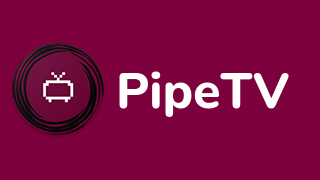
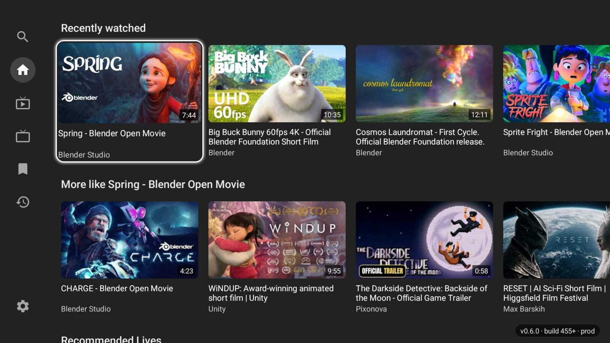
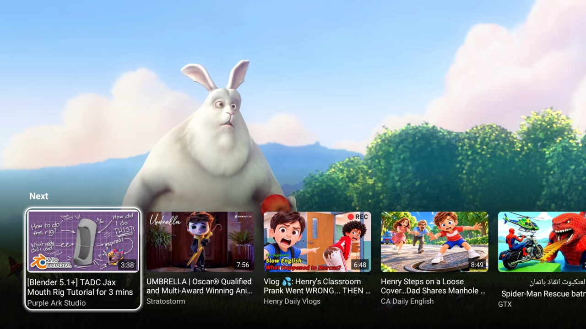
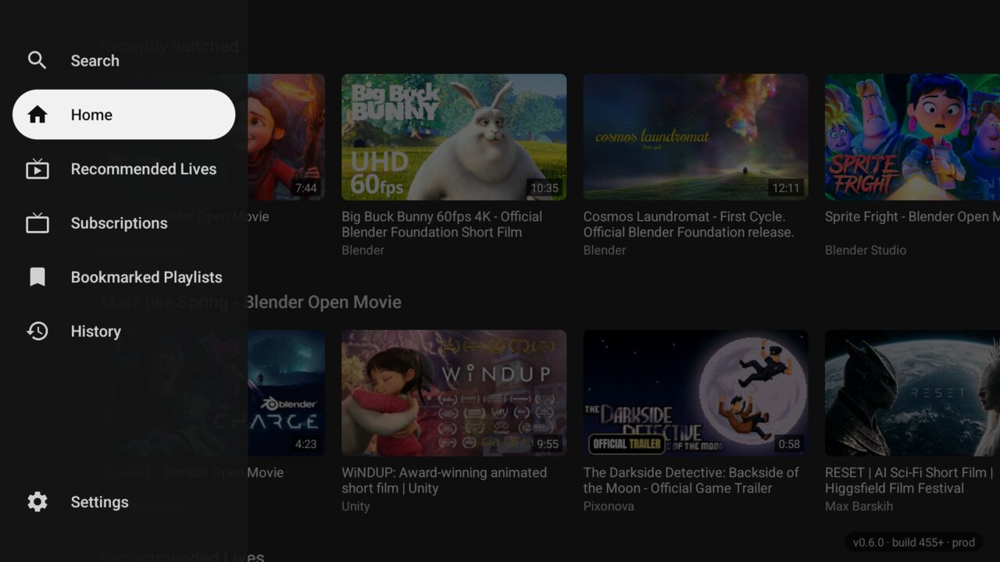
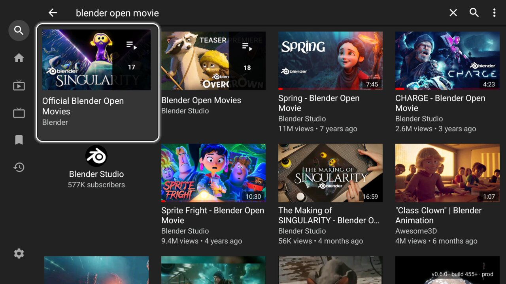
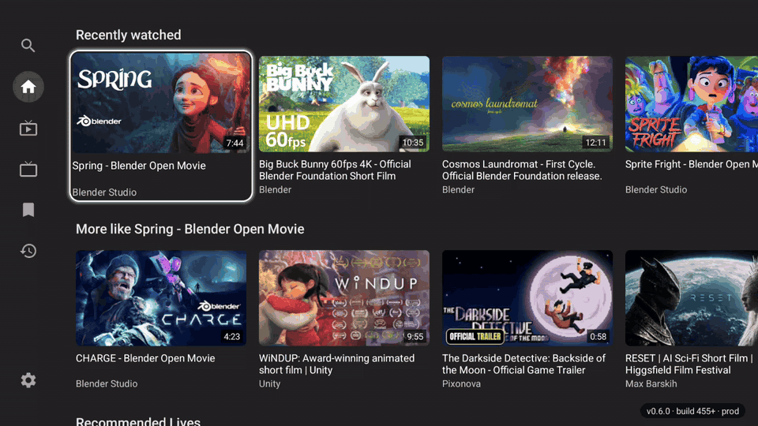

  

<h3 align="center">Videos on your TV, made for the remote</h3>

  No ads, no account, no clutter. 
  A free and open source app for Android TV and Google TV.

  <a href="https://github.com/felipebueno/PipeTV/releases/latest"><b>Download</b></a>
  &nbsp;·&nbsp;
  <a href="#install">Install</a>
  &nbsp;·&nbsp;
  <a href="#using-the-remote">Using the remote</a>
  &nbsp;·&nbsp;
  <a href="CHANGELOG.md">What's new</a>

## Why PipeTV

**Made for the remote.** Left opens the side rail, Up and Down move along it,
OK goes there. A soft white outline glides to whatever has the focus, so you
always know where you are.

**Straight to the video.** Choose a video and it plays fullscreen right away,
with no page in between. Press Down while it plays and the related videos come
up over it, as in YouTube's own TV app. Back takes you to where you were.

**A home of rows.** It opens on what you watched recently, more like the last
of it, what's live and what's new from your subscriptions.

**Light on small sticks.** Made and measured on a Mi TV Stick with 1 GB of
memory, where it opens in 2 to 3 seconds.

**Private.** No ads, no account, no tracking. Your subscriptions, history and
playlists stay on your TV, and SponsorBlock skips sponsored segments.

**Yours to tune.** Hide shorts, paid and upcoming videos, filter out keywords
or channels, choose how far Left and Right seek, or turn on DeArrow for
crowdsourced titles and thumbnails.

## Screenshots

<table>
  <tr>
    <td width="50%"></td>
    <td width="50%"></td>
  </tr>
  <tr>
    <td align="center">Down in the player brings up the related videos</td>
    <td align="center">Left opens the side rail</td>
  </tr>
  <tr>
    <td width="50%"></td>
    <td width="50%"></td>
  </tr>
  <tr>
    <td align="center">Search</td>
    <td align="center">The focus glides from card to card</td>
  </tr>
</table>

The videos in the screenshots are [Blender's open movies](https://studio.blender.org/films/)
(CC BY, Blender Foundation).

## Install

PipeTV runs on TVs, sticks and boxes with Android TV or Google TV, Android 6.0
or newer.

1. Download the APK for your device from the
   [latest release](https://github.com/felipebueno/PipeTV/releases/latest).
   Not sure which? `PipeTV-armeabi-v7a.apk` runs on nearly all of them.
2. Get it onto the TV, whichever way is easiest for you:
   - With the [Downloader](https://play.google.com/store/apps/details?id=com.esaba.downloader)
     app on the TV, open
     `https://github.com/felipebueno/PipeTV/releases/latest/download/PipeTV-armeabi-v7a.apk`
   - From a computer on the same network, with
     [adb](https://developer.android.com/tools/adb) and the TV's developer
     options on: `adb connect <the TV's IP address>`, then
     `adb install PipeTV-armeabi-v7a.apk`
   - On a USB drive, opened with a file manager on the TV
3. When the TV asks, allow that app to install unknown apps.

To update, install the newest release the same way. It installs over the one
you have and keeps your history and subscriptions. PipeTV installs next to
YouTube and PipePipe, without replacing them.

## Using the remote

| Where | Press | What happens |
|---|---|---|
| A row or list | Left, from its first item | The side rail opens |
| Side rail | Up, Down, then OK | Go to Search, Home, your tabs, History or Settings |
| Side rail | Right | Back to where you were |
| Home | Back | The side rail opens, and Back again leaves |
| Player | Left, Right | Seek right away; hold to keep seeking |
| Player | Down | The related videos come up: OK plays one, Up or Back hides them |
| Player | Back | The player closes, and you're back on the video you chose |
| Search | Back, then Down | The keyboard closes, and Down goes to the suggestions or results |

How far Left and Right seek is under Settings, Remote control.

## Built on PipePipe

PipeTV is a fork of [PipePipe](https://github.com/InfinityLoop1308/PipePipe),
which grew out of [NewPipe](https://github.com/TeamNewPipe/NewPipe). They do
the hard work of talking to YouTube; PipeTV reshapes the app for the TV and
keeps up with their updates. On a phone or tablet, PipeTV behaves like
PipePipe.

[CHANGELOG.md](CHANGELOG.md) lists what PipeTV has changed, and
[docs/DEVELOPMENT.md](docs/DEVELOPMENT.md) explains how to build it, how
releases are made and how upstream changes come in.

## License

PipeTV is free software under the [GNU General Public License v3.0](LICENSE),
like PipePipe and NewPipe. It isn't affiliated with YouTube or Google.
